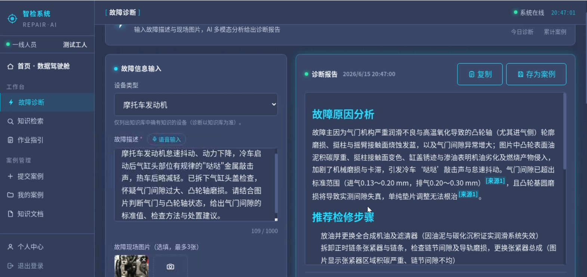
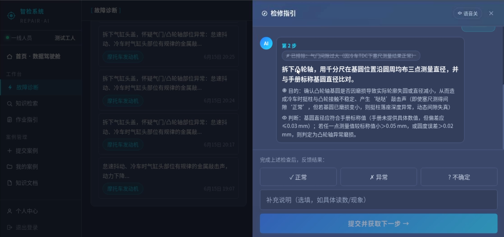
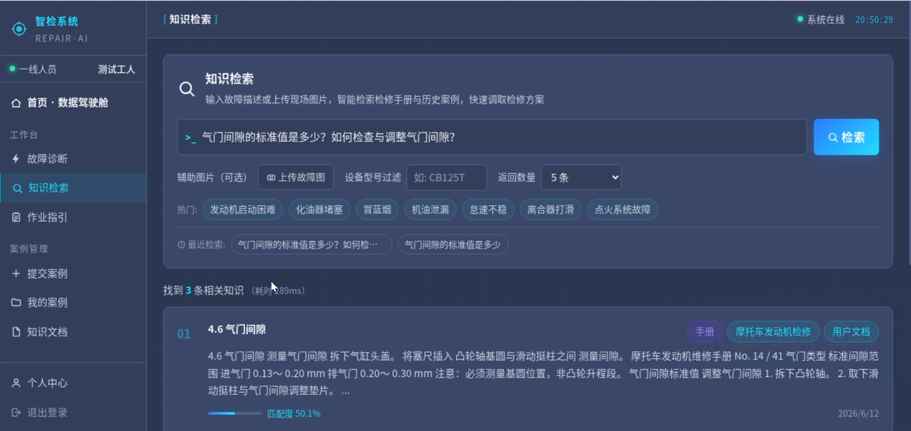
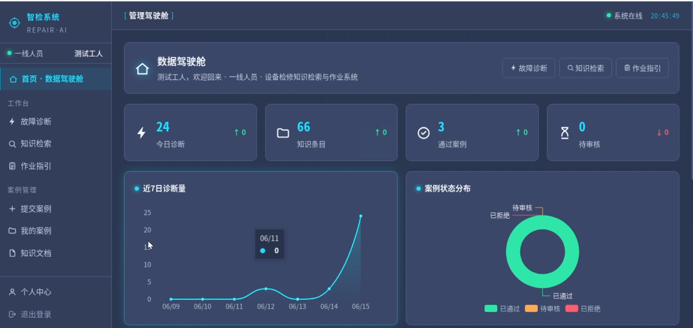
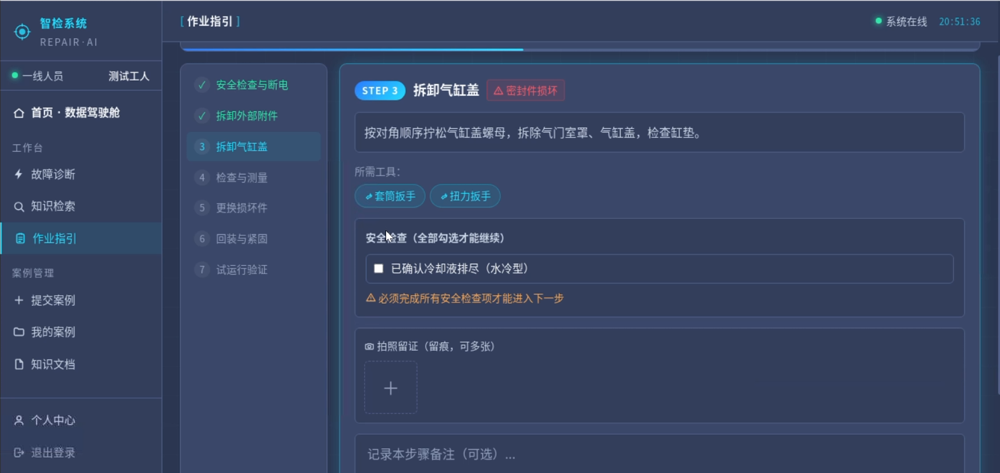
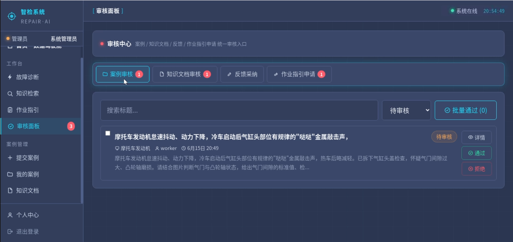
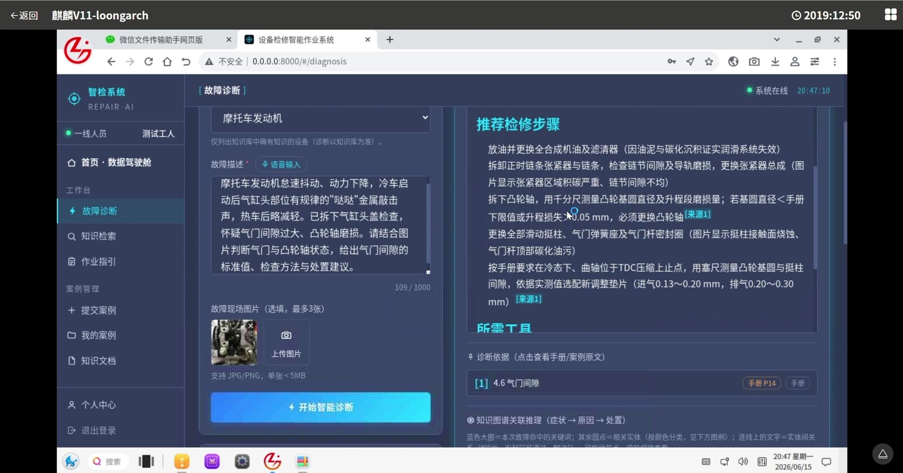
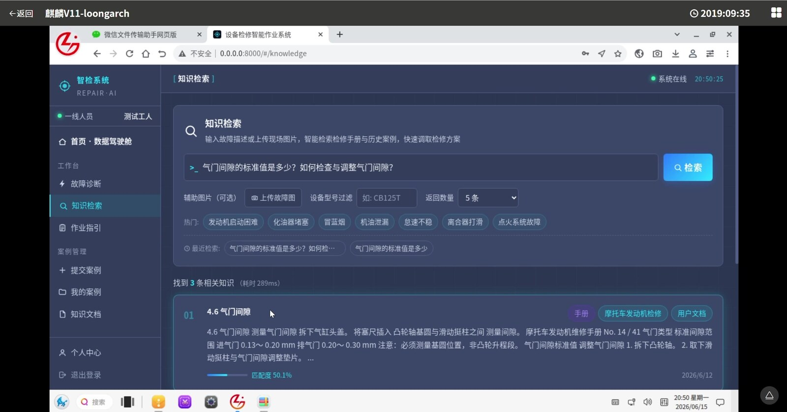
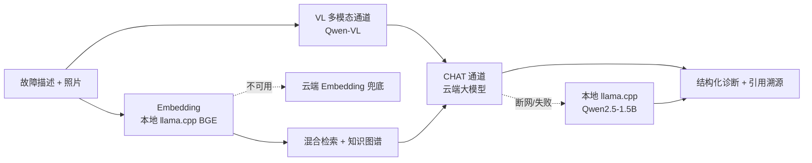
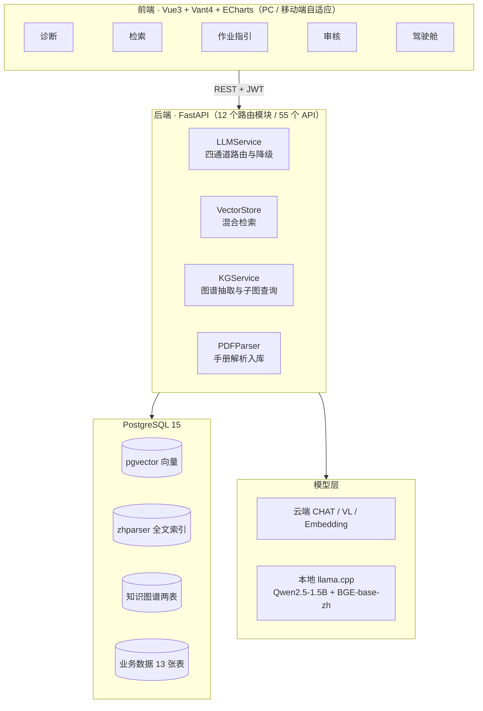

<div align="center">

# 🔧 基于多模态大模型技术的设备检修知识检索与作业系统

**拍照 + 描述故障 → 检索维修手册与历史案例 → 给出有出处的诊断与分步检修指引**

🏆 **第十五届"中国软件杯"大学生软件设计大赛 · 国家级二等奖**

赛题 A1（龙芯中科命题）· 运行于 **龙芯 LoongArch + 银河麒麟高级服务器操作系统 V11**


</div>

---

## 📖 项目简介

设备检修现场的痛点很具体：维修手册动辄几百页，经验集中在老师傅脑子里，新人遇到故障不知道从哪查起，修完了也很难证明"按规程做了"。

本系统把**维修手册、历史案例和知识图谱**统一沉淀到一个知识库中。一线人员只需**拍一张照片、说一句故障现象**，系统就会：

1. 用多模态大模型"看懂"现场照片；
2. 在知识库中做**向量 + 全文混合检索**，并沿**知识图谱**扩展相关部件与成因；
3. 生成结构化诊断结论，**每条结论都标注出自手册的哪一段**；
4. 把检修步骤拆成**可逐步勾选、拍照留痕**的作业指引；
5. 修好的案例经审核后**自动回流知识库**，越用越聪明。

整套系统面向国产化场景设计：全部依赖可在 **龙芯 LoongArch** 上编译运行，在 **4 核 8G** 的资源限制下稳定工作，**断网时自动降级到本地大模型**，保证基础诊断不中断。

---

## 🖼️ 界面展示

| 智能诊断（多模态 + 引用溯源） | 分步检修指引（可语音播报） |
|:---:|:---:|
|  |  |
| **知识检索（混合检索 + 图谱）** | **数据驾驶舱** |
|  |  |
| **标准化作业与合规留痕** | **案例审核与知识回流** |
|  |  |

<details>
<summary><b>📷 龙芯 LoongArch + 银河麒麟 V11 实机运行截图（点击展开）</b></summary>




</details>

---

## ✨ 核心功能

| 模块 | 说明 |
|---|---|
| 🩺 **多模态故障诊断** | 文字描述 + 现场照片，VL 模型解析图像特征，结合知识库输出故障分析、检修步骤、所需工具和置信度 |
| 🔎 **知识检索** | 维修手册与历史案例统一检索，支持按设备类型筛选，结果可追溯到原文段落 |
| 🧭 **分步检修指引** | 诊断结果自动转为逐步作业卡，支持勾选、拍照、语音播报，过程完整留痕 |
| 📋 **标准化作业** | 管理员按需建立保养、清洗等标准作业模板，一线执行时逐项打卡、上传照片 |
| 📝 **案例沉淀与审核** | 一线提交维修案例 → 管理员审核 → 自动向量化入库 + 知识图谱三元组抽取 |
| 📚 **文档管理** | 上传 PDF 维修手册，自动解析章节、切块、向量化，入库前自动判重 |
| 📊 **数据驾驶舱** | 诊断量、案例量、设备故障分布、环比趋势等 ECharts 可视化看板 |
| 👥 **角色权限** | 管理员 / 一线人员两种角色，前端路由守卫 + 后端 JWT 鉴权 |

---

## 💡 技术亮点

### 1. 引用溯源：每条结论都"有据可查"
大模型最大的风险是"一本正经地胡说"。系统为每条参考资料编号，要求模型在结论句末标注 `[来源N]`。前端把它渲染成可点击的角标，点开即可查看手册原文。间隙、扭矩等规格数值**只允许取自手册**，手册未覆盖时会明确注明"依据通用经验"。

### 2. GraphRAG：知识图谱参与诊断推理
从手册和案例中抽取 **部件 / 症状 / 成因 / 解决方法 / 工具** 等实体及 7 类关系，存储在 PostgreSQL 的 `kg_entities` + `kg_relations` 两张表中，不额外引入图数据库。诊断时根据检索命中扩展子图，并把推理路径可视化给用户。

### 3. 混合检索
`pgvector` 向量相似度（权重 0.7）+ `zhparser` 中文全文检索（权重 0.3），在应用层加权融合，同时兼顾语义相近和关键词精确命中。

### 4. 四通道大模型 + 云边协同降级



云端模型负责高质量推理，**本地 llama.cpp 作为兜底**：断网或云端额度耗尽时自动切换，现场诊断不中断。Embedding 同样按 `llama.cpp → ONNX → 云端 → mock` 逐级降级。

### 5. 真正跑在国产化平台上
- 推理后端统一为 **llama.cpp**（利用 LoongArch LSX/LASX 向量指令加速），一份编译产物同时承担对话与向量化；
- **pgvector、zhparser 源码编译**适配 LoongArch；
- 去除 Rust 编译依赖（Pydantic 使用 v1、去除 `cryptography` 等），保证 `pip install` 在 LoongArch 上一次通过；
- 前端构建产物由后端直接托管，部署时**无需 Node.js 和独立 Web 服务器**。

### 6. 语音交互
基于浏览器 Web Speech API 实现中文语音输入故障描述、语音朗读检修步骤，适合戴手套、双手不便的维修现场。

---

## 🏗️ 系统架构



---

## 🛠️ 技术栈

| 层 | 技术 |
|---|---|
| 前端 | Vue 3 · Vant 4 · ECharts 5 · Pinia · Vite 5 · Axios |
| 后端 | Python 3.10+ · FastAPI · SQLAlchemy 2.0（异步）· Pydantic v1 · httpx |
| 数据库 | PostgreSQL 15 · pgvector · zhparser · pg_trgm |
| 大模型 | 云端：通义千问 Qwen-Plus / Qwen-VL（OpenAI 兼容接口）<br/>本地：llama.cpp + Qwen2.5-1.5B（Q4_K_M）+ BGE-base-zh-v1.5 |
| 部署平台 | 龙芯 LoongArch LA464 · 银河麒麟高级服务器操作系统 V11（2503） |

---

## 📁 目录结构

```
├── backend/                  FastAPI 后端
│   ├── app/
│   │   ├── main.py           应用入口
│   │   ├── models/           ORM 模型（13 张表）
│   │   ├── routers/          路由（诊断、检索、案例、审核、作业、文档、驾驶舱…）
│   │   ├── services/         大模型 / Embedding / 混合检索 / 知识图谱 / PDF 解析
│   │   └── utils/            JWT 鉴权、日志
│   ├── scripts/              建库、手册解析入库、建索引、知识图谱抽取、评测脚本
│   ├── static/               前端构建产物（后端直接托管）
│   ├── .env.local            本地开发配置模板
│   └── .env.v11              银河麒麟 V11 部署配置模板
├── frontend/                 Vue3 前端源码（11 个页面）
├── docs/                     数据库搭建文档与截图
└── start_all.sh / stop_all.sh  一键启停（含本地 llama.cpp 服务）
```

---

## 🚀 快速开始

> 前置条件：PostgreSQL 15 + pgvector + zhparser，搭建步骤见 [docs/DATABASE_SETUP.md](docs/DATABASE_SETUP.md)。

```bash
# 1. 配置
cd backend
cp .env.local .env        # V11 部署请用 .env.v11
# 编辑 .env：填写数据库密码、SECRET_KEY 和大模型 API Key

# 2. 安装依赖并初始化
pip install -r requirements.txt
python scripts/check_db.py        # 数据库体检
python scripts/init_db.py         # 建表 + 演示账号 + 演示作业模板
bash scripts/seed.sh              # 导入维修手册 → 向量化 → 建索引 → 抽取知识图谱

# 3. 启动
uvicorn app.main:app --host 0.0.0.0 --port 8000
```

浏览器访问 `http://localhost:8000/` 即可使用，前端已预构建在 `backend/static/` 中。

如需修改前端：

```bash
cd frontend
npm install
npm run dev               # 开发模式 http://localhost:5173
npx vite build            # 产物自动输出到 ../backend/static
```

**演示账号**（由 `init_db.py` 创建，正式部署请修改）：

| 账号 | 密码 | 角色 |
|---|---|---|
| admin | admin123 | 管理员 |
| worker | worker123 | 一线人员 |

<details>
<summary><b>🐉 龙芯 LoongArch / 银河麒麟 V11 部署要点（点击展开）</b></summary>

1. **llama.cpp**：源码编译后启动两个进程，`11434` 端口运行 Qwen2.5-1.5B（对话兜底），`11435` 端口以 `--embedding` 模式运行 BGE-base-zh-v1.5；
2. **pgvector** 需 ≥ 0.7.4（旧版含 x86 SSE 汇编），源码编译；
3. **zhparser** 源码编译时需更新 `config.sub` 以识别 loongarch64；
4. **Python 依赖**：`requirements.txt` 中均为纯 Python 或已在 LoongArch 上验证可编译的包；`requirements-optional.txt` 仅在需要 ONNX 或现场解析 PDF 时安装；
5. **PDF 解析**：PyMuPDF 在 LoongArch 上编译较慢，可在 x86 机器上先执行 `parse_manual.py` 生成 JSON，再拷贝到 V11 执行 `ingest_manual.py`；
6. **内存**：8G 环境下评测前可执行 `sudo systemctl isolate multi-user.target` 关闭桌面，释放约 1.2GB 内存。

</details>

---

## 🏆 获奖情况

本作品获 **第十五届"中国软件杯"大学生软件设计大赛 国家级二等奖**（A1 赛题：基于多模态大模型技术的设备检修知识检索与作业系统，龙芯中科命题）。

---

## 📄 说明

本项目为参赛作品，源码公开仅供学习交流。测试使用的维修手册版权归原作者所有，未包含在本仓库中。
